# Predicting the Lifespan of Bearings Using Transformer-LSTM Networks: A Comprehensive Tutorial for Beginners!

Summary
Regarding the prediction of bearing life, there are numerous articles and codes online, but their quality is unsatisfactory, with many articles even suspected to be misleading. This issue's code was painstakingly compiled by Xiao Tao over several sleepless nights, and this issue's code can help you quickly grasp the entire process of a bearing life prediction. 
To avoid misleading my readers, this work references several highly cited classic papers on bearing life prediction and has been tested multiple times for accuracy, ensuring its reliability! The implementation details are as follows: 
Based on the PHM2012 data, we use parallel Transformer-LSTM to predict the remaining life of the bearing. The code is implemented on MATLAB 2024. The quality of the code can be verified by directly looking at the results in the following section! 
Points to note about the PHM2012 dataset  
There are many introductions to the PHM2012 dataset online, and I have also included the official documentation of this data in the code package. For a basic introduction to the PHM2012 dataset, you can refer to this link: https://zhuanlan.zhihu.com/p/583606882  
Here, I will only explain how to use this dataset! Many articles online have made mistakes when using it!  
First, here is an image of the PHM2012 dataset:  
\n        \n      Focusing on Case 1 for example. According to the official PHM2012 dataset documentation, during training set Bearing1_1 and Bearing1_2, both bearings were from healthy conditions until they completely failed. If health indicators are quantified using 0-1 scale, then the moment of complete failure corresponds to 1. So, the key point comes out!
The test set Bearing1_3~Bearing1_7, although also transitioned from a healthy state to complete failure, does not represent the entire dataset from health to complete failure as provided by the official data. Instead, it is cut off just before failure. Therefore, the end of the test set data does not represent the full failure state, and health indicators cannot be directly mapped to 1. Here are the actual time frames required for the test set to reach complete failure, which represents the true remaining life:

\n        \n  
Next steps involve training a deep learning network model on the training set and then feeding the test set into the model for prediction. This involves curve fitting the predictions to determine the time when the predicted failure occurs. The discrepancy between this time and the actual lifespan can be used to assess the quality of your model!

The official documentation also provides a scoring rule:

\n        \n  
\n        \n  
Okay, after understanding this part, let's move on to the current model prediction results!
Transformer-Lstm bearing life prediction

This code process flow:
Step one: Read the PHM2012 dataset and plot the time domain waveforms of each bearing. In this session, we use the horizontal signals of Bearing1_1 and Bearing1_2 as the training set, and Bearing1_3 and Bearing1_4 as the test set. The time domain waveforms of Bearing1_1~Bearing1_4 have been drawn out, here only show Bearing1_1:

\n        \n  
Step two: Perform a fast Fourier transform on the data obtained in Step one, here only show the first data of Bearing1_1:

\n        \n  
Step three: Feed the processed data from Step two into a parallel Transformer-Lstm network for training. The network result is as follows:
The data signals are simultaneously input into the LSTM layer (on the left) and the Transformer network (on the right). The output of the Indexing layer is then concatenated, followed by a fully connected layer, and finally, the results are output.
During the training process, Bearing1_1 and Bearing1_2 are used as the training set, while Bearing1_3 and Bearing1_4 are used as the test set.
In the fourth step, the prediction results are smoothed using a filter. Here, the predicted results for Bearing1_3 and Bearing1_4 along with the smoothed curve are plotted on the same graph:
\n        \n      \n        \n
In the fifth step, polynomial fitting is performed on the smoothed curve, selecting a cubic polynomial fit.
Then, the x-value at y=1 is calculated to determine the predicted lifespan, which is as follows:
The predicted result for Bearing1_3 is as follows:
Here, I briefly explain how to understand this image.
The official cut-off lifespan for Bearing1_3 is marked as 1801s, meaning that the bearing has not yet completely failed after reaching this point! The pink dashed line represents the smoothed prediction curve, while the blue dashed line represents the fitted curve. By predicting the blue fitted curve, the time when the bearing will fail can be determined. The black line represents the actual lifespan of the bearing, showing that the actual failure time was 2374s, whereas our model's prediction is 2262s, only 112s short of the actual remaining lifespan. The prediction effect is already quite good!
For those who are just starting to learn about lifespan prediction, you might find this concept challenging. You can refer to these documents and my results for comparison.
[1] Wang Yujing, Li Shaopeng, Kang Shouchang, et al. A rolling bearing life prediction method combining CNN and LSTM [J]. Vibration. Testing and Diagnosis, 2021, 41(03): 439-446+617. DOI: 10.16450/j.cnki.issn.1004-6801. 2021.03.003.
[2] Li Chunxiao. Research on bearing fault diagnosis and remaining life prediction based on Transformer [D]. Shijiazhuang Railway University, 2023. DOI: 10.27334/d.cnki.gstdy.2023.000614.
The first document is a highly cited paper with great reference value for those interested in bearing life prediction! The second document is closely related to our model and the graphs are also quite good, which can be referred to by everyone.
The predicted results of Bearing1_4 are as follows:
Similarly, the predicted failure time is only 148 seconds away from the actual failure time. The above two prediction results do not need secondary adjustment, just one click to output the graph!
Finally, to demonstrate the effect of the model prediction and enrich the paper's image, a tsen3-dimensional space graph was added.
Each point represents the current health indicator of the rolling bearing at that moment, and as the neural network layer deepens, the training data becomes chaotic and orderly, proving that the model can effectively identify the degradation process of the bearing.
Code directory screenshot:

## Images

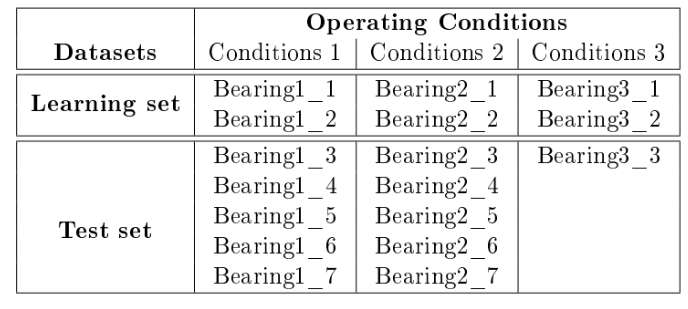
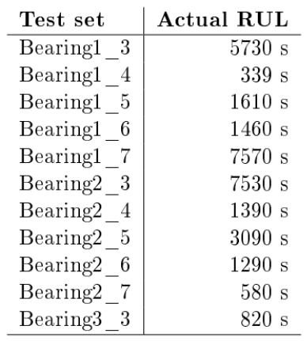
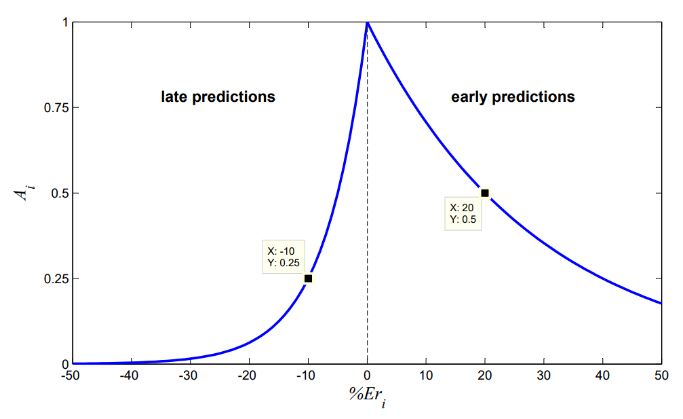
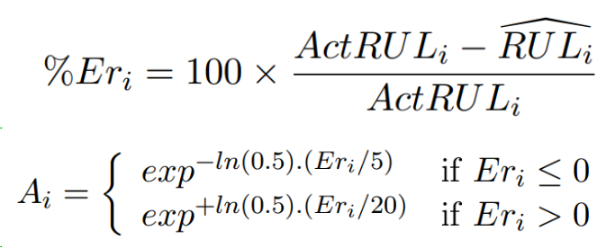
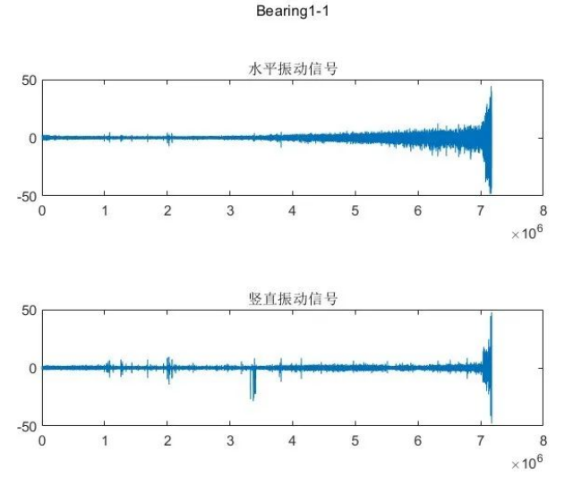
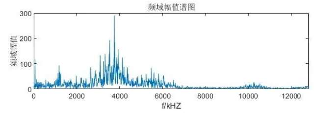
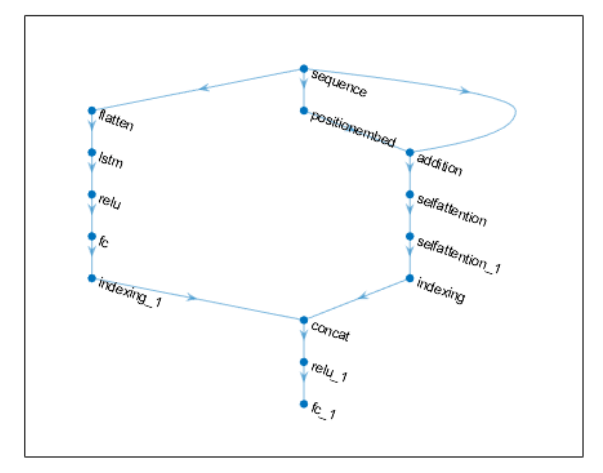
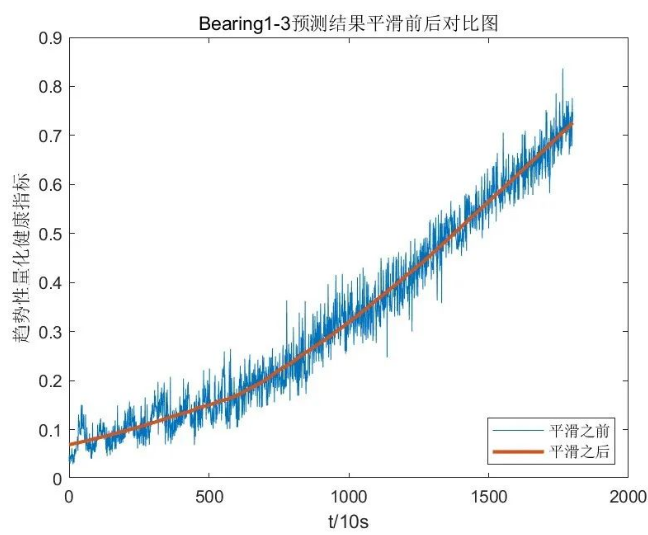
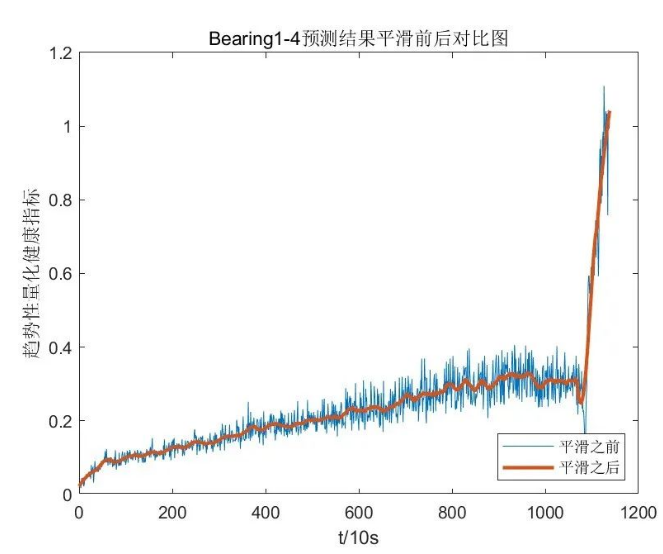
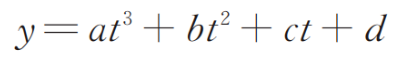
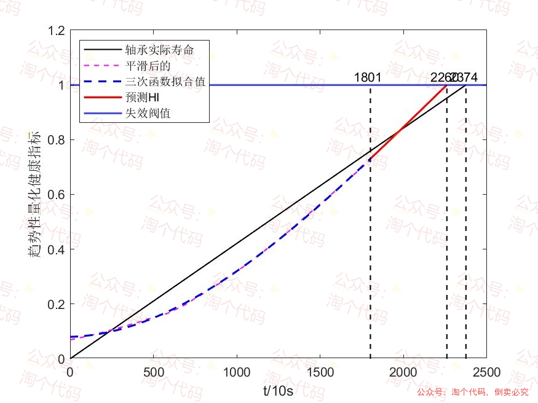
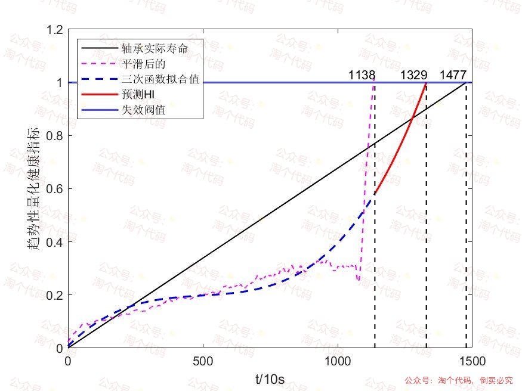
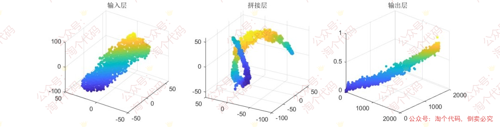
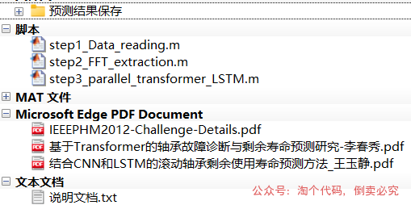

<!-- PAYMENT_BLOCK -->

## Get this dataset

- Payment link (Stripe): [Buy now](https://buy.stripe.com/3cs8yP7sY87d0vu9AB)
- Payment QR code: 

<!-- /PAYMENT_BLOCK -->
